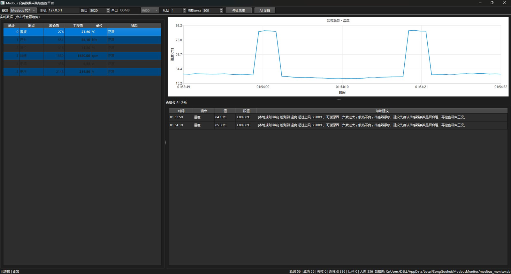

# ModbusMonitor

基于 Qt 的工业设备数据采集与监控平台。通过手写的 Modbus 协议栈采集 PLC / 传感器寄存器数据，完成实时监控、历史存储、越限告警与大模型异常诊断。

> 该项目不使用 Qt SerialBus 模块（`QModbusTcpClient` / `QSerialPort`），
> Modbus 帧编解码、CRC16、串口通信全部自行实现，因此也兼容未安装 SerialBus 组件的 Qt 环境。

---

## 项目亮点

1. **手写 Modbus 协议栈，不依赖 Qt SerialBus**
   帧编解码、CRC16（`0xA001` / 初值 `0xFFFF` / 低字节在前）、MBAP 长度切帧、
   RTU 半包收齐、异常码识别全部自行实现，因此对字节流边界有完全控制权，
   也兼容未安装 SerialBus 组件的 Qt 环境。

2. **采集与界面彻底解耦**
   独立 `std::thread` 做阻塞式一问一答轮询，界面通过 100ms 节流定时器拉取快照，
   不在 UI 线程做任何阻塞操作；采集速率与渲染速率互不影响。

3. **内存占用恒定**
   每测点一条定长环形缓冲（300 点）供曲线使用，写满覆盖最旧，长期运行不增长、
   不产生内存碎片；存储侧用有界队列（16384）在磁盘变慢时丢弃而非反压采集。

4. **存储走事务批量写入**
   独立存储线程持有自己的 SQLite 连接，一次事务提交最多 512 条采样点，
   配合 WAL 模式让查询与写入互不阻塞。

5. **告警与 AI 诊断不干扰主链路**
   越限按上升沿去重（同一次越限只告警一次）；AI 诊断异步旁路执行，
   带 Function Calling 两轮工具调用（模型可主动请求查历史数据），
   请求失败或未配置 Key 时自动降级为本地规则诊断。

6. **可验证，而不是"能跑就行"**
   自带 Modbus TCP 从站模拟器（周期性制造越限）与 25 项断言的冒烟测试，
   覆盖 CRC 已知向量、帧编解码、真实 TCP 读取、越界地址拒绝、采集线程、
   告警捕获与落库行数校验。无硬件也能完整演示。

7. **跨平台与工程化**
   串口层按 `Win32 CreateFile` / `POSIX termios` 双实现；CMake + Ninja 构建；
   `run.bat` 一键编译；`.gitignore` 隔离构建产物。

8. **踩过并修掉真实的并发坑**
   初版将 `QTcpSocket` 在主线程创建、采集线程使用，触发
   `QSocketNotifier: Socket notifiers cannot be enabled or disabled from another thread`。
   根因是 `QTcpSocket` 的线程亲和性，改为在采集线程内创建/销毁后解决。

---

## 界面预览



<sub>左侧为 6 个测点的实时值（原始值 / 工程值 / 状态），右侧为选中测点的趋势曲线；
下方告警面板记录了两次温度越限（84.10℃ / 85.30℃）及自动生成的诊断建议。</sub>

---

## 功能特性

| 模块 | 说明 |
|---|---|
| Modbus TCP 客户端 | 手写 MBAP + PDU 编解码，基于 `QTcpSocket` 阻塞式收发，支持事务号校验、超时、断线重连 |
| Modbus RTU 客户端 | 手写 CRC16（`0xA001`）、半包收齐、异常帧识别；跨平台串口封装（Win32 `CreateFile` / POSIX `termios`） |
| 采集线程 | 独立 `std::thread` 周期轮询，一问一答模型，不与 UI 线程耦合 |
| 环形缓冲区 | 定长数组 + 读写指针，保存每测点最近 300 个采样点，供曲线与 AI 上下文使用 |
| 有界线程安全队列 | `mutex + condition_variable`，队满时丢弃而非阻塞，保证采集不被磁盘 IO 拖慢 |
| SQLite 存储 | 独立存储线程 + **事务批量写入**，WAL 模式，历史数据与告警分表存储 |
| Qt 界面 | `QTableView` + 自定义 `QAbstractTableModel`、`QChart` 实时曲线、告警面板，100ms 节流刷新 |
| 越限告警 | 上升沿检测（同一次越限只告警一次），支持上下限 |
| AI 诊断 | 调大模型 API 生成诊断建议；含 **Function Calling** 两轮交互（模型可主动请求查历史数据）；无 Key 时降级为本地规则诊断 |
| 从站模拟器 | 自带 `ModbusSim`，扮演一台 6 寄存器设备，周期性制造越限，便于无硬件演示 |
| 自测 | `mb_smoke` 冒烟测试，覆盖 CRC / 帧编解码 / 真实 TCP 读取 / 采集线程 / 存储落库 |

---

## 架构

```
┌───────────────────────── 采集线程 (std::thread) ─────────────────────────┐
│  ModbusClient ( TCP: QTcpSocket  |  RTU: SerialPort )                     │
│      │ 读寄存器                                                            │
│      ▼                                                                     │
│  大端解析 + 工程值换算 (raw × scale)                                       │
│      │                                                                     │
│      ├──► 最近值快照 (mutex)  ─────────────┐                              │
│      ├──► 历史环形缓冲 RingBuffer<DataPoint>│                              │
│      ├──► 有界队列 BoundedQueue (tryPush) ──┼──► 存储线程 (事务批量写入)   │
│      └──► 越限 -> Alarm (上升沿去重)        │        │                      │
└────────────────────────────────────────────│────────│──────────────────────┘
                                             │        ▼
┌────────────────── UI 线程 (Qt 事件循环) ────┼──── SQLite (datapoint / alarm)
│  QTimer 100ms 节流刷新                      │
│    ├─ QTableView     ◄── 快照               │
│    ├─ QChart 曲线    ◄── 环形缓冲           │
│    └─ 告警面板       ◄── takeNewAlarms()    │
│           └──► AiDiagnoser (异步 HTTP, 旁路) ┘
└───────────────────────────────────────────────────────────────────────────
```

**关键设计取舍**

1. **客户端在采集线程内创建/销毁** —— `QTcpSocket` 有线程亲和性，跨线程使用会触发
   `QSocketNotifier` 警告并可能崩溃。因此客户端不持有为成员，而是在工作线程的 `run()` 中构造。
2. **队列满即丢弃** —— 工业采集场景下，实时性优先于完整性：磁盘慢不能反压采集。
3. **AI 是旁路** —— 诊断失败/超时不影响采集与告警主链路。
4. **库不用现成的** —— 手写协议栈可精确控制半包处理与异常码，也避开 Qt 模块依赖。

---

## 目录结构

```
ModbusMonitor/
├── CMakeLists.txt
├── run.bat                     一键编译脚本（纯 ASCII + CRLF）
├── src/
│   ├── main.cpp
│   ├── common/
│   │   ├── ModbusDefs.h        功能码/异常码/寄存器定义/数据点
│   │   ├── Crc16.h             CRC16（header-only）
│   │   └── Containers.h        RingBuffer + BoundedQueue（header-only）
│   ├── protocol/
│   │   ├── IModbusClient.h     客户端接口
│   │   ├── ModbusFrame.h/.cpp  PDU / RTU / MBAP 编解码
│   │   ├── SerialPort.h/.cpp   跨平台串口
│   │   ├── ModbusTcpClient.h/.cpp
│   │   └── ModbusRtuClient.h/.cpp
│   ├── core/
│   │   ├── Collector.h/.cpp    采集线程
│   │   ├── Storage.h/.cpp      SQLite 存储线程
│   │   └── AiDiagnoser.h/.cpp  AI 诊断（含 Function Calling）
│   └── ui/
│       ├── MainWindow.h/.cpp
│       ├── RealtimeTableModel.h/.cpp
│       └── TrendChart.h/.cpp
├── sim/
│   └── ModbusSim.cpp           Modbus TCP 从站模拟器
└── tests/
    └── smoke_test.cpp          冒烟测试
```

---

## 环境要求

| 组件 | 版本 |
|---|---|
| Qt | 6.8.1（mingw_64），需要 Widgets / Network / Sql / Charts |
| 编译器 | MinGW g++ 13.1.0（32/64 位均可，用 Qt 自带即可） |
| CMake | ≥ 3.21 |
| Ninja | 任意版本（可选，也可用 MinGW Makefiles） |

> ⚠️ **项目路径不要包含中文**。Qt 的 `moc` 在 Windows 上无法在非 ASCII 路径生成文件，
> 会报 `moc: Cannot create ... Error: Invalid argument`。

---

## 编译

### 一键编译（推荐）

```bat
run.bat            :: 增量编译
run.bat clean      :: 清理后全量编译
run.bat deploy     :: 编译 + windeployqt，生成可直接分发的绿色版
```

脚本会自动设置 `PATH`、`CMAKE_PREFIX_PATH` 并调用 CMake + Ninja。
若你的 Qt 装在别处，改脚本顶部的 `QT_ROOT` / `QT_VER` 即可。

### 手动编译

```bat
set QT_ROOT=E:\MySofts\Qt
set PATH=%QT_ROOT%\Tools\mingw1310_64\bin;%QT_ROOT%\6.8.1\mingw_64\bin;%PATH%

cmake -S . -B build -G Ninja ^
  -DCMAKE_BUILD_TYPE=Release ^
  -DCMAKE_PREFIX_PATH=%QT_ROOT%\6.8.1\mingw_64 ^
  -DCMAKE_MAKE_PROGRAM=%QT_ROOT%\Tools\Ninja\ninja.exe ^
  -DCMAKE_CXX_COMPILER=%QT_ROOT%/Tools/mingw1310_64/bin/g++.exe

cmake --build build --parallel
```

产物在 `build/bin/`：

- `ModbusMonitor.exe` — HMI 主程序
- `ModbusSim.exe` — Modbus TCP 从站模拟器
- `mb_smoke.exe` — 冒烟测试

---

## 部署（生成可独立运行的绿色版）

`build\bin` 里的 exe 直接双击会报缺 DLL —— 因为 Qt 和 MinGW 运行时不在系统 `PATH` 里。
`deploy.bat` 用来把这些依赖一次性收齐：

```bat
:: 在 exe 目录里直接双击，或：
cd build\bin
deploy.bat

:: 也可以在项目根目录执行（会自动定位到 build\bin）
deploy.bat

:: Qt 不在默认位置时显式指定
deploy.bat E:\MySofts\Qt\6.8.1\mingw_64
```

它做四件事：

1. 定位 Qt（命令行参数 / `QTDIR` 环境变量 / 常见安装路径）
2. 对每个 exe 执行 `windeployqt --release --force --compiler-runtime`
3. 额外拷贝 MinGW 运行时（`libstdc++-6.dll`、`libgcc_s_seh-1.dll`、`libwinpthread-1.dll`）
4. 逐项校验 11 个必需文件并打印 `[ok]` / `[MISS]`

部署完成后 `build\bin` 整个目录可以复制到**任何没有安装 Qt 的机器**上直接运行。
`run.bat deploy` 等价于「编译 + 调用 deploy.bat」。

> CMake 会在每次构建后自动把 `deploy.bat` 复制到 `build\bin`，
> 所以即使执行了 `run.bat clean` 清空构建目录，脚本依然会在 exe 旁边。
>
> 部署内容约 30 MB（Qt6Core/Gui/Widgets/Charts 占大头）。
> 若只需转发模拟器，删掉 `Qt6Widgets.dll`、`Qt6Charts.dll`、`Qt6OpenGL*.dll`、`Qt6Svg.dll` 即可，
> `ModbusSim.exe` 只依赖 `Qt6Core` + `Qt6Network`。

---

## 运行

```bat
:: 1. 启动模拟器（监听 127.0.0.1:5020，从站地址 1）
build\bin\ModbusSim.exe 5020 1

:: 2. 启动主程序
build\bin\ModbusMonitor.exe
```

主程序中点击 **开始采集**（默认参数即连接 `127.0.0.1:5020`）。
在左侧表格中点击任意行，右侧曲线会切换到该测点。

模拟器每 20 秒左右会让「温度」冲到 85℃（上限 80℃），用于触发告警与 AI 诊断。

### 自测

```bat
:: 快速（约 6 秒）
build\bin\mb_smoke.exe 127.0.0.1 5020 1

:: 完整（约 30 秒，会等一次越限告警并校验落库）
build\bin\mb_smoke.exe 127.0.0.1 5020 1 --full

:: 控制台中文编码自检（写入后从屏幕缓冲区读回比对）
build\bin\mb_console_check.exe
```

输出示例：

```
[1] CRC16 校验          3 项
[2] 帧编解码            6 项
[3] 真实 TCP 读取       4 项
[4] 采集线程            4 项
[5] 存储链路            4 项
=== 结果: 全部通过 (失败项 0)
```

---

## 默认测点

| 地址 | 测点 | 单位 | 比例 | 下限 | 上限 |
|---|---|---|---|---|---|
| 0 | 温度 | ℃ | ×0.1 | 20 | 80 |
| 1 | 压力 | kPa | ×0.1 | 0 | 100 |
| 2 | 液位 | % | ×0.1 | 10 | 90 |
| 3 | 转速 | rpm | ×1.0 | 0 | 3000 |
| 4 | 电流 | A | ×0.01 | 0 | 20 |
| 5 | 电压 | V | ×0.1 | 180 | 260 |

在 `MainWindow::buildRegisters()` 中修改。

---

## 数据库

路径：`%LOCALAPPDATA%\SongGuohui\ModbusMonitor\modbus_monitor.db`

```sql
-- 采样点
CREATE TABLE datapoint(
  id INTEGER PRIMARY KEY AUTOINCREMENT,
  ts    INTEGER NOT NULL,   -- 毫秒时间戳
  addr  INTEGER NOT NULL,
  raw   INTEGER NOT NULL,   -- 原始寄存器值
  value REAL    NOT NULL    -- 工程值
);
CREATE INDEX idx_dp_ts        ON datapoint(ts);
CREATE INDEX idx_dp_addr_ts   ON datapoint(addr, ts);

-- 告警
CREATE TABLE alarm(
  id INTEGER PRIMARY KEY AUTOINCREMENT,
  ts        INTEGER NOT NULL,
  addr      INTEGER NOT NULL,
  name      TEXT,
  value     REAL,
  limit_val REAL,
  is_high   INTEGER,
  diagnosis TEXT            -- AI 诊断结果
);
CREATE INDEX idx_alarm_ts ON alarm(ts);
```

命令行查看：

```bat
sqlite3 "%LOCALAPPDATA%\SongGuohui\ModbusMonitor\modbus_monitor.db" "SELECT COUNT(*) FROM datapoint;"
```

---

## AI 诊断配置

工具栏 **AI 设置** 里选择「常用服务」预设即可，或手动填写：

| 服务 | 接口地址 | 模型 |
|---|---|---|
| DeepSeek | `https://api.deepseek.com/chat/completions` | `deepseek-chat` |
| OpenAI | `https://api.openai.com/v1/chat/completions` | `gpt-4o-mini` |
| 其他 | 任何 OpenAI 兼容的 `/chat/completions` | 自填 |

- **API Key**：留空则使用本地规则诊断（保证无网络也能演示）
- 对话框会实时显示 `✓ 实际请求：<规范化后的地址>`，填错时红字提示

### 容易踩的坑

**坑 1：把网页控制台当成 API 端点**

`https://platform.deepseek.com/api_keys` 是**网页控制台**（在那里创建 Key），
**不是 API 端点**，填进去会报 `Error transferring ... server replied`。

程序已做防护（`AiDiagnoser::normalizeUrl` / `endpointProblem`）：

- `https://api.deepseek.com` → 自动补成 `/chat/completions`
- `https://api.deepseek.com/v1` → 自动补成 `/v1/chat/completions`
- 识别到 `platform.*` 或路径含 `api_keys` / `console` → **不发请求**，直接提示正确地址
- HTTP 401/403/404/407/429/5xx 会翻译成人话并附状态码

**坑 2：控制台刷 `qt.network.http2: stream N finished with error: "Host requires authentication"`**

这是 Qt 的 HTTP/2 层把 401/407 包装成的流错误——**看不到真实状态码，而且日志噪音很大**。
原因通常是 API Key 无效、或本机有需要认证的系统代理。

处理方式（已内置）：

- 请求强制走 **HTTP/1.1**（`Http2AllowedAttribute = false`），这样能读到 401/407 等真实状态码
- `main()` 里关闭 `qt.network.http2` 日志分类，避免噪音
- 「AI 设置」中新增 **网络代理** 选项：`系统默认` / `不使用代理`。
  若报 407，切换为「不使用代理」后重试
- 粘贴 Key 时会自动去掉首尾引号与误带的 `Bearer ` 前缀（`sanitizeKey`）

`AiDiagnoser` 内部实现了一次完整的工具调用循环：

1. 第一轮请求携带 `query_history` 工具声明；
2. 模型若返回 `tool_calls`，本地执行历史查询并把结果作为工具消息回传；
3. 第二轮请求生成最终诊断文本。

失败或超时一律降级到本地规则诊断，不阻塞主链路。

---

## 常见问题（FAQ）

**Q：控制台里中文显示成乱码（如 `鍗忚鏍?`）**

已修复。根本原因不是"代码页没切"，而是**编码来源不统一**：

- 源码里的中文字面量编译后是 **UTF-8** 字节
- 而 `qPrintable()` 内部走 `toLocal8Bit()`，产出 **GBK** 字节

两种字节混在一个流里输出，无论控制台设成哪种编码都必然有一半是乱码。

现在的做法是**不再依赖控制台代码页**（`src/common/Console.cpp`）：

| 场景 | 输出路径 |
|---|---|
| stdout 直连控制台 | `mb::cprintf()` 先把 UTF-8 转成 **UTF-16**，用 `WriteConsoleW()` 输出，由控制台原生渲染，与代码页无关 |
| stdout 被重定向 / 管道 | 直接写 **UTF-8** 字节，用 UTF-8 编辑器打开即可 |

配套改动：

- 所有输出统一走 `mb::cprintf()`，`qPrintable` 全部换成 `qUtf8Printable`（8 处）
- `SetConsoleOutputCP(CP_UTF8)` 仍然保留，作为第三方窄字节输出（如 Qt 内部日志）的兜底
- stdout 设为**无缓冲**（`_IONBF`），重定向时进程被强制结束也不丢日志

**如何自证**：项目自带 `mb_console_check.exe`，它会在控制台写入一行中文，
再用 `ReadConsoleOutputCharacterW` 从屏幕缓冲区**逐字符读回比对**：

```bat
build\bin\mb_console_check.exe
```

正常输出：

```
[PASS] 控制台读回校验通过
  输出方式    : WriteConsoleW(UTF-16)
  控制台代码页: 65001
  期望(UTF-8) : 编码自检: 温度 压力 液位 转速 27.5
  实际(UTF-8) : 编码自检: 温度 压力 液位 转速 27.5
```

若仍显示异常，按顺序检查：

1. `mb_smoke.exe` 第一行会打印 `[编码] 直连控制台 -> WriteConsoleW(UTF-16)` 或 `[编码] 输出被重定向`，
   先确认走的是哪条路径。
2. **控制台字体**：右键标题栏 → 属性 → 字体，选支持中文的字体（`新宋体` 等）。
3. **改用 Windows Terminal**，对 CJK 支持比传统 conhost 好。

> 踩坑记录：`Console.cpp` 里最初用 `Q_OS_WIN` 做平台判断，但该宏只存在于 `<QtGlobal>` 中。
> 由于这个文件不包含任何 Qt 头文件，`Q_OS_WIN` 从未定义，整个 Windows 分支被预处理器剔除，
> 修复代码实际上没被编译进去（表现为静默失效、无任何报错）。
> 现统一改用编译器内置的 `_WIN32`。

**Q：双击 exe 提示缺少 DLL**

运行 `build\bin\deploy.bat`（详见「部署」章节）。

**Q：CMake / moc 报 `Cannot create ... Error: Invalid argument`**

项目路径包含中文。Qt 的 `moc` 无法在非 ASCII 路径下生成文件，请换到纯英文路径。

**Q：把输出重定向到文件后日志是空的**

旧版 stdout 是块缓冲，进程被强制结束时会丢日志。
现已在 `initConsoleUtf8()` 中设为无缓冲（`_IONBF`），重定向也能实时落盘。

---

## 已知限制 / 后续改进

- 一次只发一个 Modbus 请求（一问一答），采集 N 个测点需 N 次往返。
  若要提速，可把连续地址合并为一次批量读（功能码 0x03 支持最多 125 个寄存器）。
- 仅实现读功能（0x03 / 0x04），未实现写寄存器、线圈操作。
- RTU 依赖请求-应答时序收包，未做 3.5 字符静默间隔的严格实现；
  多主站或广播场景需补充。
- 告警由 UI 层汇聚后交给存储线程（因为 UI 还要展示并触发 AI）；
  若需完全解耦，可在 `Collector` 注入 alarm sink 接口。
- 历史数据未做定期清理策略，长期运行需增加按时间窗口的归档/删除。

---

## License

个人项目，仅供学习与求职展示使用。
